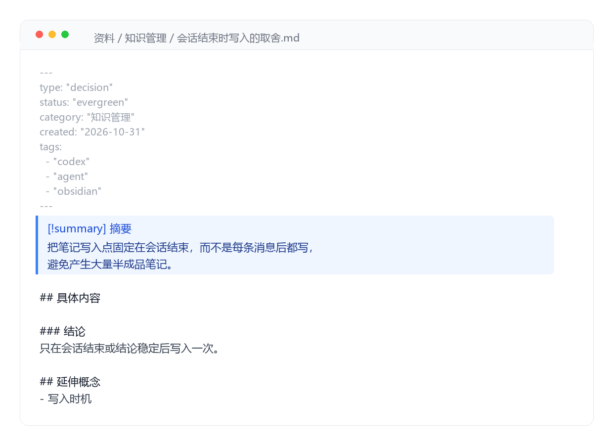
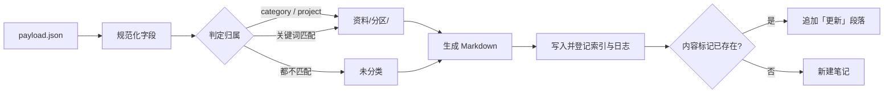

<div align="center">

# codex-vault-capture

**把和 AI 一起干活时得出的结论，落成一篇能读的 Obsidian 笔记。**

给 agent 一个固定入口：结论写成 JSON，一条命令落盘。

[](https://github.com/palmer67/codex-vault-capture/actions/workflows/ci.yml)
[](https://www.python.org/)
[](scripts/capture_to_obsidian.py)
[](LICENSE)

[快速开始](#快速开始) · [它能做什么](#它能做什么) · [工作原理](#工作原理) · [常见问题](#常见问题)

</div>

---

## 为什么

和 agent（Codex、Claude Code）干活，有用的东西往往散在对话里：哪个方案被否了、那个报错的真正原因、下一步该做什么。过两周再遇到同类问题，翻聊天记录比重新做一遍还慢。

这个工具只做一件事：**把约定好的 JSON 变成一篇结构化的笔记**，放在该在的地方，顺手登记进索引。

## 效果



输入 [`examples/input.json`](examples/input.json)：

```json
{
  "title": "为什么工具只在会话结束时写入",
  "file_title": "会话结束时写入的取舍",
  "kind": "decision",
  "summary": "把笔记写入点固定在会话结束，避免产生大量半成品笔记。",
  "category": "知识管理",
  "tags": ["Agent", "Obsidian"]
}
```

得到 `资料/知识管理/会话结束时写入的取舍.md`：

```markdown
---
type: "decision"
status: "evergreen"
category: "知识管理"
created: "2026-10-31"
tags:
  - "codex"
  - "agent"
  - "obsidian"
---

> [!summary] 摘要
> 把笔记写入点固定在会话结束，而不是每条消息后都写，避免产生大量半成品笔记。

## 具体内容
...
```

同时更新分区索引，并在 `系统/Codex/沉淀日志.md` 里记一行。完整产物见 [`examples/output-note.md`](examples/output-note.md)。

## 快速开始

需要 Python 3.9+，以及一个已初始化的 vault（目录里有 `.obsidian/`）。

```bash
git clone https://github.com/palmer67/codex-vault-capture.git
cd codex-vault-capture

# 先预演，确认路径和分类
python scripts/capture_to_obsidian.py --vault ~/Vault --json examples/input.json --dry-run

# 没问题就去掉 --dry-run
python scripts/capture_to_obsidian.py --vault ~/Vault --json examples/input.json
```

<details>
<summary>Windows 用户看这里</summary>

PowerShell 管道会把中文替换成 `?`，**不要用 `--stdin`**。把 payload 存成 UTF-8 文件，用 `--json` 传：

```powershell
$env:PYTHONUTF8='1'; $env:PYTHONIOENCODING='utf-8'
python scripts\capture_to_obsidian.py --vault "$env:USERPROFILE\Documents\Obsidian Vault" --json payload.json
```

</details>

## 它能做什么

| | |
| --- | --- |
| **结构固定** | frontmatter、摘要 callout、正文、延伸概念、来源，每篇一个样 |
| **按规则归类** | 显式 `category` 优先，其次关键词表，兜底「未分类」。不用模型判断 |
| **自动登记** | 分区索引追加链接，沉淀日志追加一行 |
| **幂等** | 同一篇再写一次只追加「更新」段落，索引不会重复登记 |
| **可预演** | `--dry-run` 打印计划，不落盘 |
| **零依赖** | 只用 Python 标准库 |

## 工作原理



第 5 步是它敢放进自动化流程的原因——重复调用不会产生第二篇笔记。

## Vault 结构

```text
vault/
├── 资料库.md              # 总入口
├── 个人/  学习/  项目/     # 其他大类
├── 资料/
│   ├── 资料.md            # 资料区索引
│   ├── AI 与自动化/
│   ├── 技术与排错/
│   └── 知识管理/
│       ├── 知识管理.md    # 分区索引
│       └── <note>.md
└── 系统/Codex/
    ├── 原始记录/
    ├── 沉淀日志.md
    └── 沉淀规则.md
```

分类节点即使只有一篇笔记也保留，图谱里才是 `资料库 → 大类 → 分区 → 笔记`，而不是全堆在中心。

## 常见问题

<details>
<summary><b>为什么不做成 Obsidian 插件？</b></summary>

插件只能在 Obsidian 界面里手动触发。这里的场景是 agent 会话结束时自动落盘，全程没人点按钮。
</details>

<details>
<summary><b>为什么用规则表分类，不上模型？</b></summary>

可解释、可测试、出错能直接改一行。分类错了打开文件就知道为什么，不用猜。
</details>

<details>
<summary><b>能当 Codex Skill 用吗？</b></summary>

能。[`SKILL.md`](SKILL.md) 是写给 agent 的操作说明（何时捕获、链接纪律、PowerShell 注意事项），和 `references/`、`scripts/` 一起放进 skills 目录即可。
</details>

## 输入字段

`title` 和 `summary` 必填，其余可选。完整说明见 [`references/input-schema.md`](references/input-schema.md)。

<details>
<summary>展开字段表</summary>

| 字段 | 作用 |
| --- | --- |
| `title` | 原始标题，用于日志和来源 |
| `file_title` | 落盘用的文件名 |
| `related` | 一到三个**已存在**的笔记，会生成 `[[wikilinks]]` |
| `concepts` | 值得留作标签、但**不要**变成链接的概念 |
| `category` | 决定落在 `资料/<category>/` 下 |
| `raw` | 原文摘录，落到 `系统/Codex/原始记录/`，不进主阅读路径 |

</details>

## 参数

<details>
<summary>展开命令行参数</summary>

```text
--vault <path>      vault 路径，也可用环境变量 OBSIDIAN_VAULT
--json <file>       payload 文件
--dry-run           只预演，不写
--auto-related      按标题精确匹配已有笔记，自动补 related
--max-related <n>   直接关联上限，默认 3
--category          指定分区
--project           指定项目名（配合 category: "项目"）
--kind              笔记类型，默认 codex-note
--stdin             从标准输入读（Windows 下不建议）
```

默认 vault 是 `~/Documents/Obsidian Vault`。

</details>

## 测试

```bash
python -m unittest discover -s tests -v
```

覆盖 frontmatter 生成、索引与日志登记、重复写入的幂等、`--dry-run` 不落盘、非 vault 路径报错。

## 已知限制

- 分类靠关键词表，不做语义判断，遇到新领域要补规则
- 面向个人 vault，不处理多人协作与冲突合并
- 没有 GUI，也没有插件版本
- 不做向量检索，搜索交给 Obsidian 自己

## 许可

[MIT](LICENSE)

<div align="center">
<sub>如果这个工具帮你省了整理笔记的功夫，点个 ⭐ 就好。</sub>
</div>
